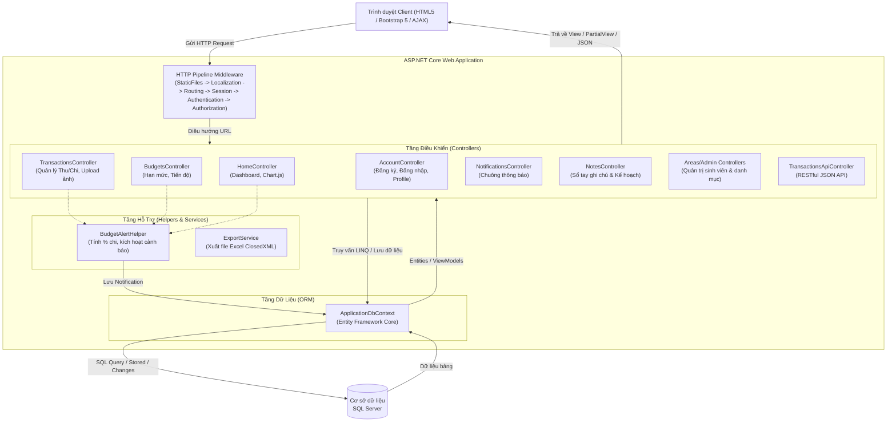
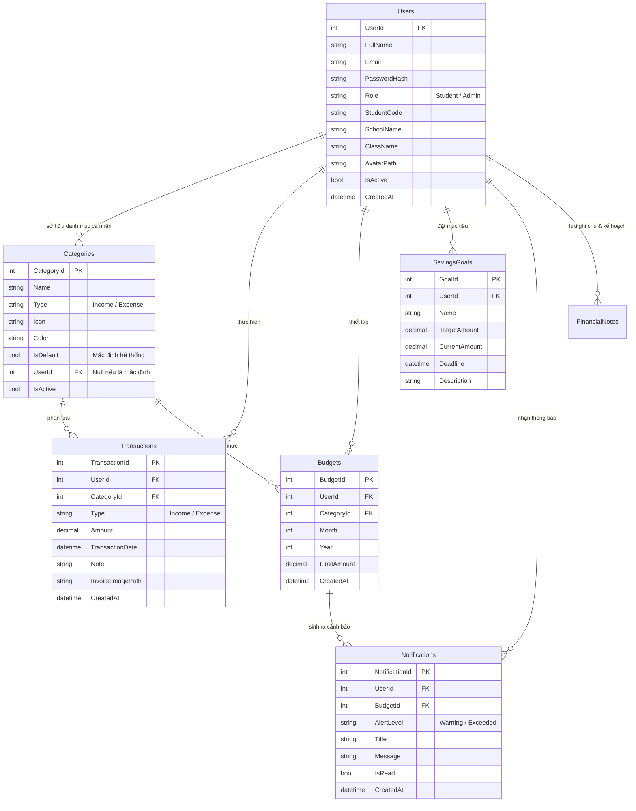
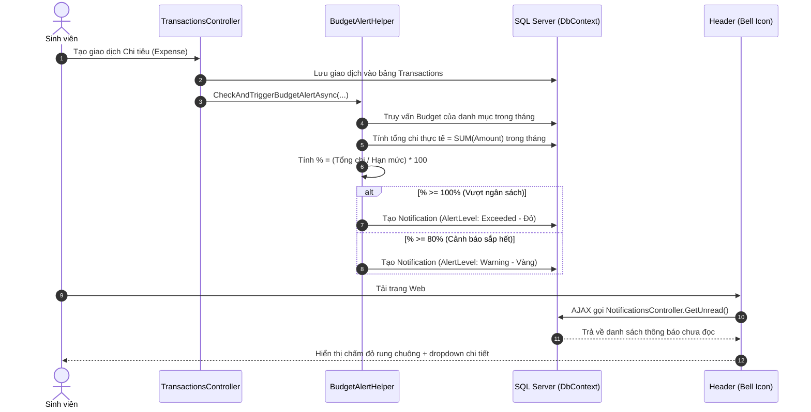

# BÁO CÁO KIẾN TRÚC HỆ THỐNG & KỊCH BẢN BẢO VỆ BTL
## ĐỀ TÀI: HỆ THỐNG QUẢN LÝ CHI TIÊU SINH VIÊN (QLChiTieuSV)
**Môn học:** Lập trình Web / Lập trình trực quan  
**Nền tảng:** ASP.NET Core 8.0/10.0 MVC, Entity Framework Core, SQL Server, Bootstrap 5  

---

> [!NOTE]
> **Tóm tắt cải tiến kiến trúc:** Toàn bộ dự án đã được tinh gọn và quy chuẩn về **Mô hình MVC 3 Tầng Chuẩn (Model - View - Controller)**. Loại bỏ các tầng Interface và Service trung gian rườm rà (`IAuthService`, `ITransactionService`, `IBudgetService`), đưa luồng xử lý đi thẳng từ **Controller -> DbContext -> CSDL**, giúp code trong sáng, trực quan, dễ hiểu và cực kỳ tự tin khi trả lời chất vấn của Thầy/Cô.

---

## MỤC LỤC
1. [Sơ đồ Kiến trúc Tổng quan (Mô hình MVC)](#1-sơ-đồ-kiến-trúc-tổng-quan-mô-hình-mvc)
2. [Thiết kế Cơ sở Dữ liệu (Database ERD)](#2-thiết-kế-cơ-sở-dữ-liệu-database-erd)
3. [Giải thích Chi tiết 4 Trọng tâm Nghiệp vụ](#3-giải-thích-chi-tiết-4-trọng-tâm-nghiệp-vụ)
   - 3.1. Luồng MVC Chuẩn (Controller ⮂ DbContext)
   - 3.2. Cảnh báo Ngân sách Tự động & Chuông Thông báo
   - 3.3. Xác thực Cookie, Phân quyền Admin (Areas) & Mã hóa BCrypt
   - 3.4. RESTful Web API (Swagger) & Xuất Báo Cáo Excel (ClosedXML)
4. [Kịch bản Thuyết trình & Demo Ứng dụng (5 - 7 Phút)](#4-kịch-bản-thuyết-trình--demo-ứng-dụng-5---7-phút)
5. [Bộ 15 Câu hỏi Vấn đáp Thường gặp & Câu trả lời Mẫu (Điểm 10/10)](#5-bộ-15-câu-hỏi-vấn-đáp-thường-gặp--câu-trả-lời-mẫu-điểm-1010)

---

## 1. SƠ ĐỒ KIẾN TRÚC TỔNG QUAN (MÔ HÌNH MVC)

Hệ thống hoạt động theo chuẩn luồng **Request - Response** của mô hình ASP.NET Core MVC:



### Ưu điểm vượt trội của thiết kế mới:
* **Tính nhất quán 100%:** Tất cả Controller đều tiêm trực tiếp `ApplicationDbContext _context`. Không còn tình trạng "chỗ thì gọi Service, chỗ lại gọi DbContext".
* **Minh bạch và dễ hiểu:** Mỗi phương thức (`Action`) đều giải quyết trọn vẹn nghiệp vụ theo các bước rõ ràng (Validate dữ liệu -> Thao tác DbContext -> Trả về kết quả).
* **Tách biệt đúng chỗ:** Các logic tính toán chung (như kiểm tra hạn mức chi) được gom vào class `BudgetAlertHelper` gọn gàng, có thể tái sử dụng ở bất kỳ đâu chỉ bằng 1 dòng gọi hàm.

---

## 2. THIẾT KẾ CƠ SỞ DỮ LIỆU (DATABASE ERD)

Cơ sở dữ liệu gồm 6 bảng thực thể quan hệ chặt chẽ với nhau:



---

## 3. GIẢI THÍCH CHI TIẾT 4 TRỌNG TÂM NGHIỆP VỤ

### 3.1. Luồng MVC Chuẩn (Controller ⮂ DbContext)
**Ví dụ thực tế: Thêm một giao dịch thu chi mới (`TransactionsController.Create`)**
1. **View (Giao diện):** Người dùng nhập form (Số tiền, Danh mục, Ngày giao dịch, Ghi chú, Ảnh hóa đơn) và bấm nút "Lưu".
2. **Controller tiếp nhận:**
   * Lấy `UserId` từ Cookie Claims của phiên đăng nhập (`GetCurrentUserId()`).
   * **Kiểm tra nghiệp vụ:** Số tiền phải > 0, ngày giao dịch không được vượt quá ngày hiện tại, danh mục phải đúng loại (`Income` hoặc `Expense`).
   * **Xử lý Upload ảnh:** Nếu có file hóa đơn, kiểm tra định dạng `.jpg`, `.png`, kích thước <= 5MB, tạo tên ngẫu nhiên `Guid` và lưu vào thư mục `wwwroot/uploads/invoices/`.
   * **Ghi nhận vào CSDL:** Gọi `_context.Transactions.Add(transaction)` và `await _context.SaveChangesAsync()`.
   * **Kích hoạt tự động:** Nếu là giao dịch chi (`Expense`), gọi `BudgetAlertHelper.CheckAndTriggerBudgetAlertAsync(...)` để kiểm tra ngay hạn mức.
3. **Phản hồi:** Đặt thông báo thành công vào `TempData["SuccessMessage"]` và chuyển hướng (`RedirectToAction`) về trang danh sách.

---

### 3.2. Cảnh báo Ngân sách Tự động & Chuông Thông báo
Cơ chế cảnh báo hoạt động theo chu trình tự động khép kín:



* **Chống spam thông báo:** Hệ thống dùng câu lệnh `AnyAsync(n => n.BudgetId == budget.BudgetId && n.AlertLevel == ...)` để kiểm tra, đảm bảo mỗi ngưỡng (80% hoặc 100%) chỉ tạo đúng **1 thông báo** trong tháng cho ngân sách đó.
* **Đánh dấu đã đọc:** Khi người dùng mở chuông xem thông báo, AJAX gọi `NotificationsController.MarkAsRead(id)` để cập nhật `IsRead = true`.

---

### 3.3. Xác thực Cookie, Phân quyền Admin (Areas) & Mã hóa BCrypt

#### A. Mã hóa mật khẩu bằng BCrypt:
* **Không lưu mật khẩu dạng thô (plain text):** Mật khẩu sinh viên được băm bằng thuật toán `BCrypt.Net.BCrypt.HashPassword(password)` có kèm muối ngẫu nhiên (salt).
* **Kiểm tra khi đăng nhập:** Gọi `BCrypt.Net.BCrypt.Verify(password, user.PasswordHash)`. Đây là chuẩn bảo mật công nghiệp, chống lại tấn công Rainbow Table.

#### B. Cơ chế Cookie Authentication:
1. Khi đăng nhập thành công, tạo danh sách các **Claims** (các mảnh thông tin định danh):
   * `ClaimTypes.NameIdentifier`: Lưu UserId
   * `ClaimTypes.Name`: Họ và tên sinh viên
   * `ClaimTypes.Email`: Email
   * `ClaimTypes.Role`: Vai trò (`Student` hoặc `Admin`)
   * `StudentCode`, `AvatarPath`: Thông tin kèm theo
2. Đóng gói Claims vào `ClaimsIdentity` và ghi vé bảo mật xuống trình duyệt qua:
   ```csharp
   await HttpContext.SignInAsync(CookieAuthenticationDefaults.AuthenticationScheme, 
       new ClaimsPrincipal(claimsIdentity), authProperties);
   ```
3. Các request tiếp theo, trình duyệt tự gửi Cookie lên. Middleware `UseAuthentication()` giải mã cookie và gán vào thuộc tính `User` của Controller.

#### C. Phân quyền và Phân hệ Admin (`Areas/Admin`):
* Controller của Admin được đặt trong thư mục `Areas/Admin/Controllers/` và đánh dấu các Attribute:
  ```csharp
  [Area("Admin")]
  [Authorize(Roles = "Admin")]
  public class HomeController : Controller { ... }
  ```
* Nếu sinh viên cố tình gõ link `/Admin/Home`: Middleware `UseAuthorization()` thấy `Role != "Admin"` sẽ chặn lại ngay lập tức và điều hướng sang trang `/Account/AccessDenied` (Từ chối truy cập).

---

### 3.4. RESTful Web API (Swagger) & Xuất Báo Cáo Excel (ClosedXML)

#### A. Xuất Báo Cáo Tài Chính Excel (ClosedXML):
* **Class tiện ích `ExportService` (trong thư mục `Helpers/`):** Sử dụng thư viện `ClosedXML` để tạo trực tiếp file `.xlsx` trong bộ nhớ (`MemoryStream`).
* Báo cáo bao gồm:
  - Header tiêu đề định dạng màu sắc trang trọng, hợp nhất ô (Merge cells).
  - Thông tin sinh viên (Họ tên, Mã SV, Trường, Lớp).
  - Danh sách giao dịch chi tiết theo tháng với định dạng số tiền chuẩn `#,#0`.
  - Hàng tổng thu, tổng chi và số tiền chênh lệch (dư/hụt) tự động tô màu trực quan (xanh/đỏ).
* Trong `ReportsController`, người dùng bấm "Xuất Excel", controller gọi `_exportService.ExportMonthlyReportToExcel(...)` và trả về `File(bytes, "application/vnd.openxmlformats-officedocument.spreadsheetml.sheet", fileName)`.

#### B. RESTful Web API & Swagger UI:
* Controller `Controllers/Api/TransactionsApiController.cs` kế thừa `ControllerBase`, đánh dấu `[ApiController]` và `[Route("api")]`.
* Trả về dữ liệu định dạng **JSON** chuẩn cho 3 endpoint chính:
  * `GET /api/transactions`: Danh sách giao dịch có lọc và phân trang.
  * `GET /api/transactions/balance`: Số dư, tổng thu, tổng chi.
  * `GET /api/categories`: Danh mục thu chi.
* **Tích hợp Swagger UI:** Khi ứng dụng chạy ở môi trường Development, truy cập `/swagger` sẽ mở trang giao diện tương tác cho phép chạy thử các API trực tiếp trên trình duyệt mà không cần cài đặt phần mềm Postman.

---

## 4. KỊCH BẢN THUYẾT TRÌNH & DEMO ỨNG DỤNG (5 - 7 PHÚT)

Khi lên bảng bảo vệ BTL, bạn tự tin trình bày theo kịch bản 5 bước sau:

* **Bước 1: Giới thiệu đề tài & Công nghệ (1 phút):**
  > *"Kính thưa Thầy/Cô, nhóm em xin phép trình bày Bài tập lớn 'Hệ thống Quản lý Chi tiêu Sinh viên'. Đề tài được xây dựng trên nền tảng ASP.NET Core MVC, Entity Framework Core và CSDL SQL Server. Ứng dụng giải quyết bài toán giúp sinh viên ghi nhận thu chi hằng ngày, thiết lập hạn mức ngân sách và tự động cảnh báo khi vượt ngân sách."*

* **Bước 2: Demo Đăng nhập & Phân quyền (1 phút):**
  > *"Em xin demo đăng nhập tài khoản sinh viên `student@utc.edu.vn`. Mật khẩu được mã hóa an toàn bằng thuật toán BCrypt. Sau khi đăng nhập, hệ thống cấp vé Cookie Authentication lưu thông tin sinh viên."*

* **Bước 3: Demo Dashboard & Thống kê trực quan (1.5 phút):**
  > *"Tại Dashboard trang chủ, sinh viên thấy ngay 4 thẻ thống kê tài chính: Số dư hiện tại, Thu nhập, Chi tiêu tháng và Chi tiêu bình quân mỗi ngày. Hai biểu đồ Chart.js trực quan: Cơ cấu chi tiêu theo danh mục (Doughnut chart) và So sánh dòng tiền Thu - Chi 6 tháng gần nhất (Bar chart)."*

* **Bước 4: Demo Thu Chi, Lọc AJAX và Kích hoạt Cảnh báo Ngân sách (2 phút - Trọng tâm ghi điểm):**
  > *"Em vào trang Giao dịch. Khi em lọc theo tháng hoặc tìm kiếm từ khóa, trang web sử dụng AJAX để load lại bảng dữ liệu mượt mà mà không tải lại toàn bộ trang.  
  > Bây giờ, em thêm một khoản chi 'Ăn uống' với số tiền 850.000đ. Do tháng này em đặt ngân sách ăn uống là 1.000.000đ, khoản chi này làm tổng chi đạt trên 80% hạn mức. Ngay lập tức chuông thông báo trên Header báo đỏ! Mở chuông ra sẽ thấy cảnh báo: 'Bạn đã sử dụng 85% ngân sách Ăn uống tháng này'."*

* **Bước 5: Demo Xuất Excel & Khu vực Quản trị Admin (1.5 phút):**
  > *"Tại trang Báo cáo, sinh viên có thể bấm 'Xuất Excel' để tải file báo cáo tài chính định dạng chuẩn `.xlsx` được tạo tự động bằng thư viện ClosedXML.  
  > Cuối cùng, khi đăng nhập bằng tài khoản `admin@utc.edu.vn`, hệ thống điều hướng vào Phân hệ Quản trị (Area Admin) cho phép quản lý danh sách sinh viên, khóa tài khoản vi phạm và quản lý các danh mục mặc định của hệ thống."*

---

## 5. BỘ 15 CÂU HỎI VẤN ĐÁP THƯỜNG GẶP & CÂU TRẢ LỜI MẪU (ĐIỂM 10/10)

### Câu 1: Em hãy giải thích mô hình MVC trong dự án này hoạt động như thế nào?
* **Trả lời:**
  > *"Thưa Thầy/Cô, mô hình MVC trong dự án chia thành 3 thành phần rõ rệt:  
  > 1. **Model:** Nằm trong thư mục `Models/` (chứa các Entity như `Transaction`, `Budget`, `AppUser`) ánh xạ tới các bảng trong SQL Server thông qua `ApplicationDbContext`.  
  > 2. **View:** Nằm trong thư mục `Views/`, sử dụng cú pháp Razor (`.cshtml`) và Bootstrap 5 để hiển thị giao diện cho người dùng.  
  > 3. **Controller:** Nằm trong thư mục `Controllers/`, đóng vai trò tiếp nhận HTTP Request từ View, kiểm tra tính hợp lệ dữ liệu, gọi `DbContext` để truy vấn hoặc cập nhật CSDL, sau đó truyền Model/ViewBag sang View hoặc trả về JSON."*

---

### Câu 2: Tại sao em không dùng Identity mặc định mà lại tự xây dựng Cookie Authentication?
* **Trả lời:**
  > *"Thưa Thầy/Cô, ASP.NET Core Identity mặc định sinh ra rất nhiều bảng phức tạp không cần thiết cho phạm vi bài toán sinh viên. Em chủ động xây dựng Cookie Authentication để kiểm soát 100% cấu trúc CSDL bảng `Users`, tự quản lý các Claims định danh và tối ưu tốc độ ứng dụng. Đồng thời mật khẩu vẫn được bảo mật an toàn tuyệt đối bằng thư viện `BCrypt.Net`."*

---

### Câu 3: Thuật toán BCrypt khác gì so với MD5 hoặc SHA256? Tại sao em chọn BCrypt?
* **Trả lời:**
  > *"Thưa Thầy/Cô, MD5 và SHA256 là các hàm băm tốc độ cao và có tính cố định; nếu 2 người đặt cùng mật khẩu '123456' thì chuỗi băm ra hoàn toàn giống nhau, hacker có thể dùng từ điển Rainbow Table để dịch ngược trong vài giây.  
  > BCrypt là thuật toán chuyên dụng để băm mật khẩu, có tích hợp cơ chế muối ngẫu nhiên (Salt) và hệ số chi phí (Work Factor). Cùng một mật khẩu '123456' nhưng mỗi lần băm sẽ ra một chuỗi khác nhau, chống lại triệt để kiểu tấn công brute-force và rainbow table."*

---

### Câu 4: Làm thế nào để ngăn chặn sinh viên này xem hoặc xóa giao dịch của sinh viên khác?
* **Trả lời:**
  > *"Thưa Thầy/Cô, trong tất cả các phương thức truy vấn và cập nhật (`Edit`, `Delete`, `Index`), em không bao giờ tin tưởng `UserId` gửi từ form của người dùng. Em luôn lấy `UserId` chuẩn từ vé Cookie đã được mã hóa bằng hàm `User.FindFirstValue(ClaimTypes.NameIdentifier)`. Trong câu lệnh LINQ luôn có điều kiện `Where(t => t.TransactionId == id && t.UserId == currentUserId)`. Vì vậy dù kẻ xấu cố tình sửa `TransactionId` trên trình duyệt thì hệ thống cũng không tìm thấy bản ghi và từ chối xử lý."*

---

### Câu 5: Lọc dữ liệu AJAX và phân trang PartialView hoạt động như thế nào?
* **Trả lời:**
  > *"Thưa Thầy/Cô, khi người dùng đổi tháng hoặc gõ từ khóa, đoạn mã JavaScript jQuery sẽ gửi một request ngầm (AJAX) lên `TransactionsController.Index`.  
  > Trong Controller, em kiểm tra header `Request.Headers["X-Requested-With"] == "XMLHttpRequest"`. Nếu là AJAX, Controller không tải lại cả layout trang web mà chỉ trả về duy nhất file `PartialView("_TransactionListPartial", transactions)`. JavaScript nhận mã HTML này và thay thế (`html()`) vào thẻ `<div>` chứa bảng, giúp trang web mượt mà và tiết kiệm băng thông."*

---

### Câu 6: Cơ chế tự động kích hoạt cảnh báo ngân sách hoạt động ở đâu trong code?
* **Trả lời:**
  > *"Thưa Thầy/Cô, cơ chế này nằm trong hàm `BudgetAlertHelper.CheckAndTriggerBudgetAlertAsync`. Nó được tự động gọi ở 2 thời điểm: khi sinh viên tạo/sửa giao dịch Chi tiêu (`TransactionsController`) và khi sinh viên thiết lập hạn mức ngân sách (`BudgetsController`).  
  > Hàm sẽ tính tổng chi thực tế của danh mục trong tháng so với hạn mức: nếu đạt từ 80% đến dưới 100% thì tạo bản ghi thông báo mức 'Warning', nếu từ 100% trở lên thì tạo thông báo mức 'Exceeded', đồng thời kiểm tra trước để tránh tạo trùng lặp thông báo."*

---

### Câu 7: Dependency Injection (DI) được áp dụng như thế nào trong dự án?
* **Trả lời:**
  > *"Thưa Thầy/Cô, DI được cấu hình trong file `Program.cs`. Em đăng ký các dịch vụ như `AddDbContext<ApplicationDbContext>`, `AddScoped<ExportService>()`. Khi các Controller được khởi tạo, ASP.NET Core Runtime tự động tiêm (inject) các instance này thông qua Constructor của Controller. Điều này giúp code lỏng lẻo (loose coupling), dễ bảo trì và quản lý vòng đời tài nguyên hiệu quả."*

---

### Câu 8: Entity Framework Core Code-First hay Database-First? Giải thích DbContext?
* **Trả lời:**
  > *"Thưa Thầy/Cô, dự án sử dụng EF Core Code-First. Các bảng dữ liệu được định nghĩa bằng các lớp C# Entity trong thư mục `Models/`. `ApplicationDbContext` kế thừa từ `DbContext`, chứa các thuộc tính `DbSet<Transaction>`, `DbSet<Budget>`... đóng vai trò là cầu nối giữa mã nguồn C# và SQL Server, tự động chuyển đổi các câu lệnh LINQ thành câu lệnh SQL thuần."*

---

### Câu 9: Tính năng kế thừa ngân sách tự động từ tháng trước hoạt động như thế nào?
* **Trả lời:**
  > *"Thưa Thầy/Cô, khi sinh viên mở xem ngân sách của tháng mới (ví dụ tháng 11), hàm `EnsureBudgetsInheritedAsync` kiểm tra xem tháng 11 đã có bản ghi nào chưa. Nếu chưa có, hệ thống tự động tìm ngân sách của tháng 10 liền kề và sao chép toàn bộ danh mục cùng hạn mức sang tháng 11. Nhờ vậy sinh viên không phải nhập lại ngân sách mỗi khi bước sang tháng mới."*

---

### Câu 10: Phân hệ Admin (Area Admin) được bảo vệ như thế nào?
* **Trả lời:**
  > *"Thưa Thầy/Cô, Phân hệ Admin sử dụng tính năng **Area** của ASP.NET Core (`[Area("Admin")]`). Để bảo vệ, em gắn Attribute `[Authorize(Roles = "Admin")]` lên các Controller của Admin. Khi có yêu cầu truy cập, middleware xác thực kiểm tra Claim `Role` của người dùng. Nếu chưa đăng nhập thì chuyển về `/Account/Login`, nếu đã đăng nhập nhưng `Role == "Student"` thì lập tức chuyển hướng về `/Account/AccessDenied`."*

---

### Câu 11: Tại sao em dùng ClosedXML để xuất Excel thay vì xuất file CSV?
* **Trả lời:**
  > *"Thưa Thầy/Cô, file CSV chỉ là văn bản phân tách bằng dấu phẩy, không hỗ trợ định dạng màu sắc hay tiếng Việt có dấu tốt trên các máy tính khác nhau. Em sử dụng thư viện ClosedXML để sinh ra file Excel chuẩn định dạng `.xlsx`, có thể tô màu tiêu đề, in đậm, gộp ô (Merge cells), định dạng số tiền có dấu chấm phân cách hàng nghìn và hiển thị đầy đủ thông tin sinh viên in báo cáo."*

---

### Câu 12: Đa ngôn ngữ (Localization) lưu trạng thái người dùng chọn ở đâu?
* **Trả lời:**
  > *"Thưa Thầy/Cô, đa ngôn ngữ lưu trạng thái trong Cookie mang tên `.AspNetCore.Culture`. Khi sinh viên chọn Tiếng Anh, `LanguageController` ghi cookie với giá trị `c=en|uic=en`. Ở các request tiếp theo, middleware `UseRequestLocalization` tự động đọc cookie này để chọn file tài nguyên tương ứng (`.en.resx` hoặc `.vi.resx`) để hiển thị giao diện."*

---

### Câu 13: Swagger UI là gì và nó giúp ích gì cho dự án?
* **Trả lời:**
  > *"Thưa Thầy/Cô, Swagger là công cụ sinh tài liệu trực quan cho RESTful Web API từ mã nguồn C#. Nhờ cấu hình `AddSwaggerGen()` và `UseSwaggerUI()`, khi truy cập `/swagger`, Thầy/Cô có thể thấy danh sách toàn bộ các API của hệ thống (`GET /api/transactions`, `/api/balance`, `/api/categories`), xem cấu trúc dữ liệu JSON trả về và có thể bấm 'Try it out' để test API trực tiếp ngay trên trình duyệt."*

---

### Câu 14: Biểu đồ Chart.js lấy dữ liệu từ Controller sang View như thế nào?
* **Trả lời:**
  > *"Thưa Thầy/Cô, trong `HomeController.Index`, em dùng LINQ `GroupBy` theo danh mục để tính tổng tiền từng nhóm. Sau đó em dùng thư viện `System.Text.Json.JsonSerializer.Serialize` để chuyển các mảng nhãn (Labels) và mảng số liệu (Data) thành chuỗi JSON và gán vào `ViewBag`. Sang View `Home/Index.cshtml`, đoạn script JavaScript nhận chuỗi JSON này qua lệnh `@Html.Raw(ViewBag.DoughnutData)` và nạp vào đối tượng Chart của thư viện Chart.js để vẽ biểu đồ."*

---

### Câu 15: Nếu hệ thống có hàng triệu giao dịch, em sẽ tối ưu hiệu năng như thế nào?
* **Trả lời:**
  > *"Thưa Thầy/Cô, em sẽ áp dụng 4 giải pháp:  
  > 1. **Đánh chỉ mục (Index):** Tạo Composite Index trên bảng `Transactions` cho các cột `(UserId, TransactionDate, CategoryId)`.  
  > 2. **Phân trang tại Database:** Duy trì cơ chế `Skip` và `Take` trong LINQ như hiện tại để chỉ tải đúng 10 bản ghi mỗi trang thay vì tải toàn bộ.  
  > 3. **Truy vấn AsNoTracking:** Với các truy vấn chỉ để hiển thị báo cáo, thêm `.AsNoTracking()` để EF Core không tốn bộ nhớ theo dõi đối tượng.  
  > 4. **Caching:** Sử dụng `MemoryCache` hoặc `Redis` để lưu các danh mục mặc định và số dư tổng quan thay vì truy vấn SQL liên tục."*

---

> [!TIP]
> **Lời khuyên khi vấn đáp:** Hãy trả lời với thái độ bình tĩnh, tự tin, mắt nhìn thẳng vào Thầy/Cô. Khi giải thích code, chủ động mở đúng file Controller liên quan và chỉ vào từng dòng chú thích tiếng Việt rõ ràng đã được thiết kế sẵn.
