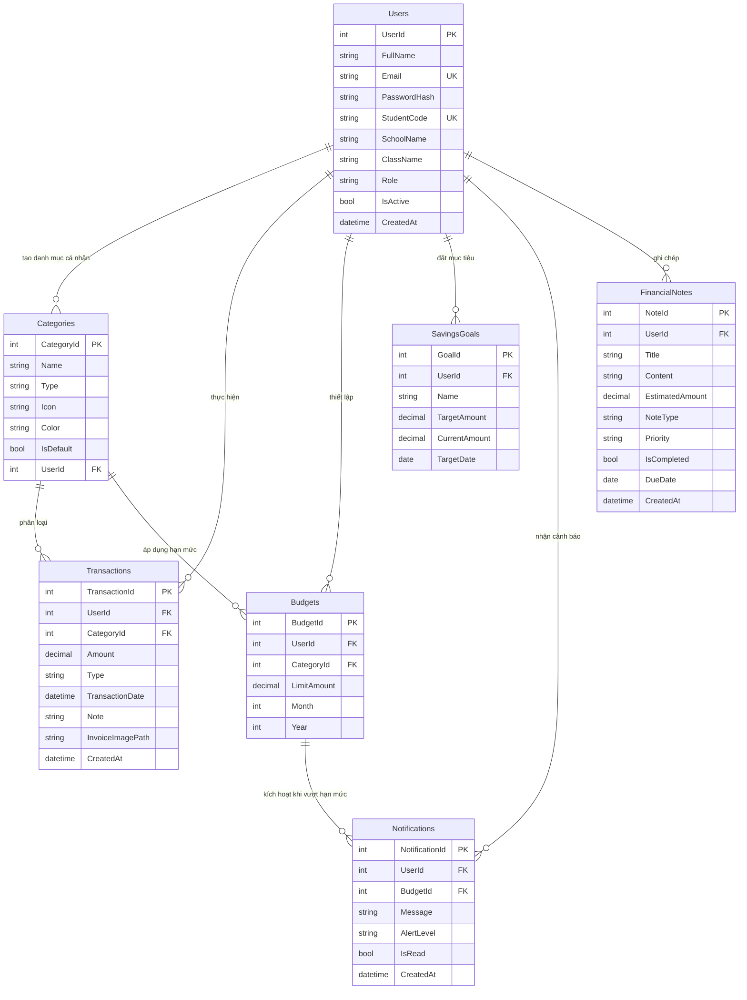

# 🎓 HỆ THỐNG QUẢN LÝ CHI TIÊU SINH VIÊN (QLChiTieuSV)
> **Bài tập lớn môn Lập trình Web**  
> **Trường Đại học Giao thông Vận tải (UTC) — Khoa Công nghệ Thông tin**


---

## 📖 1. Giới Thiệu Dự Án

**Hệ thống Quản lý Chi tiêu Sinh viên** là ứng dụng web toàn diện giúp sinh viên đại học theo dõi, kiểm soát và tối ưu hóa ngân sách cá nhân. Ứng dụng giải quyết triệt để bài toán tài chính sinh viên:
* Kiểm soát các khoản chu cấp từ gia đình, tiền làm thêm, học bổng và các khoản chi thiết yếu (tiền nhà trọ, ăn uống, học phí, xe cộ,...).
* **Cảnh báo thông minh** khi sắp hoặc đã vượt hạn mức ngân sách tháng để tránh tình trạng "cháy túi" cuối tháng.
* Lập kế hoạch tích lũy tài chính qua các mục tiêu tiết kiệm và sổ ghi chú tài chính tương lai.
* Phân hệ quản trị giúp Nhà trường / Quản trị viên nắm bắt bức tranh tổng thể về thói quen chi tiêu của sinh viên.

---

## 🛠️ 2. Công Nghệ Sử Dụng (Tech Stack)

| Thành phần | Công nghệ / Thư viện | Vai trò trong hệ thống |
|---|---|---|
| **Ngôn ngữ & Nền tảng** | **C# 13**, **.NET 10.0** (ASP.NET Core MVC) | Xử lý logic Backend, Routing, Controllers, Middleware |
| **Cơ sở Dữ liệu & ORM** | **Microsoft SQL Server**, **Entity Framework Core 10** | Lưu trữ quan hệ 3NF, truy vấn LINQ tối ưu với `.AsNoTracking()` |
| **Xác thực & Bảo mật** | **Cookie Authentication**, **BCrypt.Net-Next** | Vé đăng nhập Cookie, mã hóa mật khẩu 1 chiều chuẩn BCrypt, CSRF Protection |
| **Giao diện Người dùng (UI)** | **HTML5, CSS3, JavaScript (ES6+), Bootstrap 5** | Giao diện chuẩn Responsive, Bootstrap Icons tinh gọn, nhẹ nhàng |
| **Tương tác Động** | **AJAX (Fetch API)** | Lọc dữ liệu, phân trang và tải danh sách không tải lại trang |
| **Biểu đồ Thống kê** | **Chart.js** | Biểu đồ tròn Doughnut (cơ cấu danh mục) & Biểu đồ cột Bar (so sánh 6 tháng) |
| **Báo cáo & Xuất file** | **ClosedXML** | Xuất báo cáo tài chính chi tiết định dạng Excel (`.xlsx`) |
| **Tài liệu Web API** | **Swashbuckle (Swagger UI / OpenAPI)** | Tài liệu hóa và kiểm thử trực quan RESTful API tại `/swagger` |

---

## 📁 3. Cây Thư Mục Dự Án (Project Structure)

```plaintext
BTL_LTWEB_QLChiTieu/
│
├── Areas/                               # Phân hệ Quản trị viên (Admin Area)
│   └── Admin/
│       ├── Controllers/
│       │   ├── HomeController.cs        # Thống kê tổng quan sinh viên & dòng tiền toàn trường
│       │   └── StudentsController.cs    # Quản lý danh sách sinh viên, khóa/mở tài khoản, xem chi tiết
│       └── Views/
│           ├── Home/Index.cshtml        # Dashboard Admin
│           ├── Students/                # Giao diện danh sách & chi tiết sinh viên
│           └── Shared/_AdminLayout.cshtml # Layout riêng cho Quản trị viên
│
├── Controllers/                         # Controllers của Phân hệ Sinh viên
│   ├── AccountController.cs             # Đăng ký, đăng nhập linh hoạt, đăng xuất, hồ sơ cá nhân
│   ├── HomeController.cs                # Dashboard sinh viên: 4 thẻ thống kê, biểu đồ Chart.js
│   ├── TransactionsController.cs        # Quản lý thu chi, lọc AJAX, upload ảnh hóa đơn
│   ├── BudgetsController.cs             # Thiết lập hạn mức ngân sách tháng & theo dõi tiến độ
│   ├── SavingsGoalsController.cs        # Mục tiêu tích lũy tiết kiệm & nạp tiền
│   ├── NotesController.cs               # Ghi chú tài chính & kế hoạch chi tiêu tương lai
│   ├── NotificationsController.cs       # Danh sách thông báo & đánh dấu đã đọc
│   ├── ReportsController.cs             # Thống kê báo cáo & xuất dữ liệu ra Excel
│   ├── CategoriesController.cs          # Quản lý danh mục thu/chi cá nhân
│   └── Api/
│       └── TransactionsApiController.cs # RESTful API (JSON) cho ứng dụng mở rộng
│
├── Data/
│   └── ApplicationDbContext.cs          # Cấu hình EF Core, chỉ mục (Indexes), khóa ngoại & Seed Data
│
├── Helpers/                             # Các dịch vụ dùng chung trong hệ thống
│   ├── BudgetAlertHelper.cs             # Thuật toán tính toán chi tiêu & kích hoạt cảnh báo ngân sách
│   └── ExportService.cs                 # Dịch vụ xuất dữ liệu báo cáo ra file Excel (.xlsx)
│
├── Models/                              # Thực thể Cơ sở dữ liệu (Domain Entities)
│   ├── AppUser.cs                       # Bảng Users (Sinh viên & Admin)
│   ├── Category.cs                      # Bảng Categories (Danh mục thu chi)
│   ├── Transaction.cs                   # Bảng Transactions (Giao dịch thu/chi)
│   ├── Budget.cs                        # Bảng Budgets (Hạn mức ngân sách tháng)
│   ├── SavingsGoal.cs                   # Bảng SavingsGoals (Mục tiêu tiết kiệm)
│   ├── Notification.cs                  # Bảng Notifications (Cảnh báo vượt hạn mức)
│   └── FinancialNote.cs                 # Bảng FinancialNotes (Ghi chú & kế hoạch tài chính)
│
├── ViewModels/                          # Mô hình dữ liệu truyền nhận giữa View và Controller
│   ├── LoginViewModel.cs                # Dữ liệu đăng nhập (Email/Username/Mã SV)
│   ├── RegisterViewModel.cs             # Dữ liệu đăng ký rút gọn, tiện lợi
│   ├── ProfileViewModel.cs              # Dữ liệu hồ sơ cá nhân & upload avatar
│   └── BudgetProgressViewModel.cs       # Dữ liệu hiển thị tiến độ hạn mức ngân sách
│
├── Views/                               # Giao diện người dùng Razor Views (.cshtml)
│   ├── Account/                         # Giao diện Đăng nhập, Đăng ký, Hồ sơ cá nhân
│   ├── Home/Index.cshtml                # Dashboard tổng quan tài chính sinh viên
│   ├── Transactions/                    # Danh sách giao dịch, lọc AJAX, Modal thêm/sửa
│   ├── Budgets/Index.cshtml             # Giao diện ngân sách tháng & thanh tiến độ
│   ├── SavingsGoals/Index.cshtml        # Danh sách mục tiêu tiết kiệm
│   ├── Notes/Index.cshtml               # Sổ ghi chú kế hoạch chi tiêu
│   ├── Reports/Index.cshtml             # Báo cáo tổng hợp & nút xuất Excel
│   ├── Categories/Index.cshtml          # Quản lý danh mục cá nhân
│   └── Shared/
│       ├── _Layout.cshtml               # Khung sườn giao diện chính (Header, Chuông báo, Footer)
│       └── _ValidationScriptsPartial.cshtml
│
├── wwwroot/                             # Tài nguyên tĩnh phía Client
│   ├── css/site.css                     # Tùy biến kiểu dáng giao diện
│   ├── js/site.js                       # Xử lý tương tác AJAX, Client-side scripts
│   └── uploads/                         # Nơi lưu trữ ảnh thật do người dùng tải lên
│       ├── avatars/                     # Ảnh đại diện tài khoản
│       └── invoices/                    # Ảnh chứng từ, hóa đơn giao dịch
│
├── Program.cs                           # Cấu hình nạp Middleware, DI, Cookie Auth, Session, Swagger
├── QLchitieusinhvien.sql                # Script SQL Server tạo CSDL & nạp dữ liệu mẫu
├── appsettings.json                     # Cấu hình chuỗi kết nối Database Connection String
└── README.md                            # Tài liệu hướng dẫn dự án chi tiết
```

---

## 🗄️ 4. Thiết Kế Cơ Sở Dữ Liệu (Database Schema & ERD)

Cơ sở dữ liệu **`QUANLYCHITIEUSINHVIEN`** được thiết kế chuẩn hóa quan hệ (3NF) gồm **7 bảng**:

### 4.1. Sơ đồ Quan hệ Thực thể (ERD)



### 4.2. Danh sách 7 Bảng Chi Tiết

1. **`Users`**: Lưu trữ tài khoản người dùng, phân quyền `Role` (`Student` hoặc `Admin`), mật khẩu mã hóa BCrypt, trạng thái khóa tài khoản `IsActive`.
2. **`Categories`**: Danh mục thu/chi. Phân loại danh mục hệ thống mặc định (`IsDefault = 1`) và danh mục do sinh viên tự bổ sung (`UserId IS NOT NULL`).
3. **`Transactions`**: Bản ghi giao dịch thu hoặc chi của sinh viên, đính kèm số tiền, ngày giao dịch, ghi chú và đường dẫn ảnh hóa đơn. Có Index tối ưu trên `(UserId, TransactionDate)`.
4. **`Budgets`**: Hạn mức ngân sách tối đa cho từng danh mục trong một tháng cụ thể. Ràng buộc Unique `(UserId, CategoryId, Month, Year)`.
5. **`SavingsGoals`**: Kế hoạch tiết kiệm tích lũy, số tiền mục tiêu, số tiền đã tích lũy và ngày dự kiến đạt được.
6. **`Notifications`**: Cảnh báo vượt hạn mức chi tiêu được hệ thống tự động sinh ra (`AlertLevel`: `Warning` khi đạt 80%, `Danger` khi vượt 100%).
7. **`FinancialNotes`**: Sổ ghi chép các dự định, khoản chi tiêu tương lai cần chuẩn bị, mức độ ưu tiên (`High`, `Normal`, `Low`) và trạng thái hoàn thành.

---

## ✨ 5. Các Tính Năng Nổi Bật

### 🎓 A. Phân Hệ Sinh Viên
* **Đăng ký & Đăng nhập gọn gàng**: Đăng ký nhanh chỉ với Họ tên, Email, Mật khẩu. Đăng nhập linh hoạt bằng Email, Tên (`student`) hoặc Mã sinh viên (`211200001`).
* **Bảng điều khiển Tài chính (Dashboard)**:
  * 4 Thẻ chỉ số tức thời: *Số dư hiện tại*, *Thu nhập tháng*, *Chi tiêu tháng*, *Chi tiêu bình quân ngày*.
  * Biểu đồ tròn **Doughnut**: Tỷ lệ phần trăm cơ cấu các khoản chi trong tháng.
  * Biểu đồ cột **Bar**: So sánh tương quan dòng tiền Thu - Chi trong 6 tháng gần nhất.
  * Bảng hiển thị 5 giao dịch phát sinh gần nhất và thanh tiến độ hạn mức tháng.
* **Quản lý Thu Chi & Chứng từ**:
  * Thêm/sửa/xóa giao dịch có kiểm tra tính hợp lệ số tiền và ngày giao dịch.
  * Tải lên ảnh hóa đơn, biên lai chuyển khoản (hỗ trợ JPG, PNG, WEBP tối đa 5MB).
  * **Bộ lọc và phân trang AJAX**: Lọc theo tháng, năm, loại giao dịch, danh mục và từ khóa mà không cần tải lại toàn bộ trang web.
* **Ngân sách Thông minh & Cảnh báo Tự động**:
  * Thiết lập hạn mức chi tiêu cho từng danh mục (Ăn uống, Nhà trọ, Đi lại, Học tập,...).
  * Hệ thống tự động so khớp sau mỗi giao dịch chi tiêu:
    * 🟡 Cảnh báo vàng: Chi tiêu chạm ngưỡng **80%** hạn mức.
    * 🔴 Cảnh báo đỏ: Chi tiêu vượt quá **100%** hạn mức.
  * Tự động gửi thông báo đến **Biểu tượng Chuông** trên thanh điều hướng Header.
* **Mục tiêu Tiết kiệm**:
  * Tự động tính toán số tiền còn thiếu, số ngày còn lại và **số tiền cần tiết kiệm mỗi ngày** để đạt mục tiêu.
  * Tính năng nạp tiền nhanh vào mục tiêu tiết kiệm.
* **Ghi chú Tài chính (Tính năng mới)**:
  * Lên danh sách các việc cần chi trả sắp tới (đóng tiền trọ, mua sách giáo trình, nộp học phí).
  * Phân loại mức độ ưu tiên và ngày hết hạn, bấm đánh dấu hoàn thành chỉ với 1 click.
* **Xuất Báo Cáo Excel**:
  * Tạo file Excel `.xlsx` chuyên nghiệp bằng ClosedXML, có tiêu đề báo cáo, thông tin sinh viên, bảng thống kê và công thức tổng dòng tiền.
* **Hồ sơ Cá nhân**: Cập nhật thông tin sinh viên, mã sinh viên, trường, lớp và thay đổi ảnh đại diện.

### 🛡️ B. Phân Hệ Quản Trị Viên (Admin Area - `/Admin`)
* **Thống kê toàn diện**: Tổng số tài khoản sinh viên, tổng số giao dịch, tổng dòng tiền lưu chuyển trong hệ thống.
* **Quản lý Sinh viên**:
  * Tra cứu, tìm kiếm sinh viên theo tên, email, mã sinh viên, khoa, lớp.
  * Xem báo cáo chi tiết thu nhập, chi tiêu, số dư và danh sách giao dịch của từng sinh viên.
  * **Khóa / Mở khóa tài khoản** sinh viên có hiệu lực ngay lập tức.
* **Quản lý Danh mục Mặc định**: Thêm/sửa/khóa các danh mục dùng chung toàn trường.

### ⚡ C. RESTful Web API & Swagger UI
* Hỗ trợ các endpoint trả về dữ liệu chuẩn JSON:
  * `GET /api/transactions`: Lấy danh sách giao dịch có phân trang.
  * `GET /api/transactions/balance`: Lấy số dư hiện tại của tài khoản.
  * `GET /api/categories`: Lấy danh mục thu/chi.
* Tích hợp sẵn **Swagger UI** tại đường dẫn `/swagger` để kiểm thử trực quan.

---

## 🚀 6. Hướng Dẫn Cài Đặt & Chạy Ứng Dụng

### Bước 1: Khởi tạo Cơ sở Dữ liệu
1. Mở **SQL Server Management Studio (SSMS)** và kết nối vào SQL Server cục bộ (`localhost` hoặc `.` hoặc `.\SQLEXPRESS`).
2. Mở file script [QLchitieusinhvien.sql](file:///d:/Code/UTC/ky%205/Lap%20Trinh%20Truc%20Quan/BTL_LTWEB_QLChiTieu/QLchitieusinhvien.sql).
3. Bấm **Execute (F5)** để tự động tạo cơ sở dữ liệu `QUANLYCHITIEUSINHVIEN`, 7 bảng quan hệ và nạp sẵn dữ liệu mẫu thực tế.

### Bước 2: Kiểm tra Chuỗi Kết Nối
Mở file `appsettings.json` tại thư mục gốc và đảm bảo chuỗi kết nối khớp với máy tính của bạn:
```json
{
  "ConnectionStrings": {
    "DefaultConnection": "Server=localhost;Database=QUANLYCHITIEUSINHVIEN;Trusted_Connection=True;MultipleActiveResultSets=true;TrustServerCertificate=True"
  }
}
```
*(Nếu sử dụng SQL Server Authentication, bạn có thể thay bằng `Server=localhost;Database=QUANLYCHITIEUSINHVIEN;User Id=sa;Password=your_password;TrustServerCertificate=True`)*.

### Bước 3: Khởi chạy Ứng dụng
Mở Terminal / PowerShell tại thư mục dự án và chạy các lệnh sau:
```bash
# Phục hồi các gói thư viện NuGet
dotnet restore

# Biên dịch dự án
dotnet build

# Khởi chạy ứng dụng
dotnet run
```
Mở trình duyệt web và truy cập đường dẫn: **`http://localhost:5222`** (hoặc port hiển thị trên console).

---

## 👥 7. Tài Khoản Kiểm Thử (Demo Accounts)

| Phân hệ | Tài khoản đăng nhập | Mật khẩu | Chức năng kiểm thử |
|---|---|---|---|
| **Sinh viên** | `student@utc.edu.vn`<br/>*(hoặc `student` / `211200001`)* | `Student@123` | Dashboard biểu đồ, quản lý thu chi, ngân sách, ghi chú, xuất Excel |
| **Quản trị viên** | `admin@utc.edu.vn`<br/>*(hoặc `admin`)* | `Admin@123` | Quản lý sinh viên toàn trường, khóa/mở tài khoản (`/Admin`) |

---

## 📝 8. Giấy Phép & Bản Quyền

Dự án được phát triển phục vụ mục đích học tập và bảo vệ Bài tập lớn môn **Lập trình Web** tại **Trường Đại học Giao thông Vận tải (UTC)**.
* Sinh viên thực hiện: **Trần Nhật Thạch**
* Lớp: **CNTT K62**
